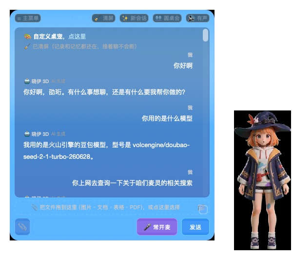

# MateClaw 麦灵（ML）｜官方发行与说明仓库


**在你自己电脑上跑的中文 AI 助手。免费功能无需注册；聊天与文件留在本机，服务器只保存账号、订单和付费功能凭证。**

> 本仓库由麦灵科技（大城县）有限公司维护。官方网址：<https://www.mateclawml.com>。请以本页、`mateclawml` GitHub 组织和官方网站发布的信息为准。

真实界面长这样：



一张图看懂它能干什么：

- **桌面宠物**：常驻一个会动、会说话的小助手，2D 和 3D 都有，能换角色、能换形象。
- **多个角色，各自记事**：每个角色有自己的记忆，换个角色就是换个人，不会串台。
- **模型自己挑**：本地跑或用你自己的密钥，对话不经过我们的服务器。
- **能动手办事**：读文件、做表格、写东西、定时记事、语音对话，都在桌面上直接来。
- **苹果和 Windows 都能装**：macOS 15.7 以上（Apple 芯片）、Windows 10/11 六十四位。

> ⚠️ 本仓库是**公开的发行与说明页**，不是开源代码仓库。软件源代码不公开。
> 本产品是**基于 OpenClaw（MIT 许可）的独立发行版，与 OpenClaw 官方无隶属、代理、赞助或背书关系。**

---

## 这是什么

麦灵把「一个大模型助手」做成了桌面上随手可用的东西：常驻一个会说话、会动的小助手，能读文件、能做表格、能写东西、能定时记事。模型由你自己选、自己付费给厂商，我们不经手。

- 系统：macOS 15.7 及以上（Apple 芯片）；Windows 10/11 64 位
- 界面语言：**目前仅中文**
- 免费版永久免费；全能版一次性买断
- 聊天、记忆、桌宠素材和文件内容存在本机；账号、订单和付费功能凭证保存在官方服务器
- 音视频处理（视频抽帧、音频转换）**不在安装包里**，按需安装开源插件，见 [插件](#插件)

## 下载

到 [Releases](https://github.com/mateclawml/mateclaw/releases) 页下载安装包，页面附 SHA-256 校验值。

| 平台 | 文件 | 状态 |
| --- | --- | --- |
| macOS（Apple 芯片） | `MateClaw-1.0.30.dmg` | 已签名并公证，系统 15.7 起 |
| Windows（64 位） | `MateClaw-Windows-1.1.28.zip` | **未签名**，安装时需点「仍要运行」 |

两个包都与官网 <https://www.mateclawml.com/#download> 提供的文件完全一致，未做任何改动。

> 页底的 **Source code (zip / tar.gz)** 两个压缩包由 GitHub 自动为每个发行版生成，内容是本页的说明文档（十几 KB 文字），**不含任何软件代码**。软件源代码不公开。

**关于 Windows 版没有签名：** 这一版用的是我们自己提交的证书，正在走微软的审核流程，还没批下来；线下购买的那套证书这次不使用。所以 Windows 会显示「未知发布者」提示，点「更多信息 → 仍要运行」即可。提示是系统对所有未签名程序的统一行为，不代表文件有问题——用下面的校验值可以自行确认。

**关于 Windows 版仍带 FFmpeg：** 1.1.28 是拆分之前打的包，安装包里还有一个 FFmpeg 可执行文件（GPL 授权、未修改的预编译二进制）。我们照原样分发，并在 [THIRD-PARTY-NOTICES.md](THIRD-PARTY-NOTICES.md) 里写明源码获取方式与书面提供承诺。下一版会把它移除，改用插件。macOS 1.0.30 则不含 FFmpeg。

安装前请核对校验值：

```bash
shasum -a 256 MateClaw-1.0.30.dmg          # macOS
certutil -hashfile MateClaw-Windows-1.1.28.zip SHA256   # Windows
```

## 安装

打开 `.dmg`，把「麦灵」拖进「应用程序」。首次启动如提示「无法验证开发者」，到「系统设置 → 隐私与安全性」点「仍要打开」。

首次启动会引导你选模型服务商、填自己的密钥。密钥只存在本机。

## 插件

安装包保持精简，附加能力用**开源插件**提供，代码公开、可自行审计、可自己改。

| 插件 | 用途 | 许可 | 仓库 |
| --- | --- | --- | --- |
| 音视频组件 | 视频抽帧、音频提取与转码 | MIT（调用系统 FFmpeg） | [mateclawml/media-plugin](https://github.com/mateclawml/media-plugin) |

当前插件尚未发布到 npm，需要从源码安装。请先确认 `ffmpeg` 和 `ffprobe` 已在 `PATH` 中，然后在终端执行：

```bash
git clone https://github.com/mateclawml/media-plugin.git
cd media-plugin
npm ci
npm run build
openclaw plugins install ./
```

安装要求、FFmpeg 安装方式和故障排查见 [插件仓库的 README](https://github.com/mateclawml/media-plugin#readme)。**macOS 1.0.30 安装包不含 FFmpeg 二进制**；Windows 1.1.28 是拆分之前的打包，仍内置一个，下一版移除。

## 关于本仓库

| 内容 | 是否公开 |
| --- | --- |
| 说明文档、截图、发布说明、问题模板 | 公开 |
| 安装包与校验值 | 公开 |
| 发行页底部自动生成的 Source code 压缩包 | 公开（仅说明文档，不含软件代码） |
| 软件源代码、构建脚本、签名证书 | 不公开 |
| 收费、激活、支付后端 | 不公开 |

- 许可见 [LICENSE](LICENSE)（仅覆盖本仓库内容，不覆盖软件本体）。
- 第三方组件与许可见 [THIRD-PARTY-NOTICES.md](THIRD-PARTY-NOTICES.md)。
- 安全问题请见 [SECURITY.md](SECURITY.md)，**不要**在公开问题区贴漏洞细节。
- 我们**不接受软件本体的代码合并请求**（Pull Request），因为源代码不公开；插件仓库是开源的，那边欢迎 PR。问题与建议随时提。

## 反馈

- 安装、启动、崩溃 → 用「安装 / 启动问题」模板
- 功能不对、结果异常 → 用「功能异常」模板
- 想要什么功能 → 用「功能建议」模板

请附上：系统版本、麦灵版本号、复现步骤、截图或日志。**不要贴密钥、身份证、聊天记录等敏感内容。**

## 购买与支持

免费版可直接下载使用。全能版与售后支持请到官网：<https://www.mateclawml.com>

本仓库不放价格，也不做收银台。

## 商标与致谢

「MateClaw」「麦灵」由麦灵科技（大城县）有限公司使用并维护。具体商标申请与权利状态以国家知识产权局公示信息为准。

感谢 OpenClaw（MIT）、FFmpeg、Live2D Cubism 及所有开源作者。

---

# English

**MateClaw is a desktop AI assistant for Chinese users, running on your own machine.** No registration is required for the free features. Chats and files stay on your device; the official server stores only account, order and paid-feature entitlement records.

> This repository is maintained by MateClaw Technology (Dacheng County) Co., Ltd. Official website: <https://www.mateclawml.com>. Please treat this page, the `mateclawml` GitHub organization and the official website as the authoritative sources.

> ⚠️ This repository is a **public release and documentation page**, not an open-source code repository. The application source code is not public.
> This product is an **independent distribution based on OpenClaw (MIT License)** and is **not affiliated with, endorsed by, or sponsored by the OpenClaw project.**

**Current limitations, stated plainly:**

- **The user interface is Chinese only.** There is no language switcher yet.
- Documentation here is bilingual; the in-app experience is not.
- **The Windows build is not code-signed yet.** SmartScreen will warn about an unknown publisher; choose "More info → Run anyway". A signing certificate is pending Microsoft's review. Both files here are byte-identical to the official website builds.
- The Windows 1.1.28 installer still bundles a prebuilt FFmpeg binary (GPL, unmodified). It is distributed as-is, with source-provision details and a written offer in [THIRD-PARTY-NOTICES.md](THIRD-PARTY-NOTICES.md). The next Windows build removes it. The macOS 1.0.30 installer contains no FFmpeg.

**Download** from [Releases](https://github.com/mateclawml/mateclaw) and verify the published SHA-256 checksums. macOS builds are signed and notarized; Windows builds are not yet signed. Official site: <https://www.mateclawml.com>.

**Requirements:** macOS 15.7+ (Apple silicon), or 64-bit Windows 10/11. The interface is Chinese only.

**Media features are a plugin, not part of the installer.** Video frame extraction and audio conversion ship as a separate open-source plugin ([mateclawml/media-plugin](https://github.com/mateclawml/media-plugin), MIT) that calls your own FFmpeg installation. The plugin is not yet published to npm; until then, follow the source-install steps in the plugin repository. The macOS installer contains no FFmpeg binary; Windows 1.1.28 still bundles one and will drop it in the next build.

**Licensing:** repository content is covered by [LICENSE](LICENSE). The application itself is licensed under a separate end-user license agreement available at <https://www.mateclawml.com>. Third-party components are listed in [THIRD-PARTY-NOTICES.md](THIRD-PARTY-NOTICES.md).

**No pull requests for the application** — its source is closed. The plugin repository is open source and PRs are welcome there. Issues and feature requests are welcome here.

**Purchase and support:** <https://www.mateclawml.com>

---

*维护：麦灵科技（大城县）有限公司 ｜ 联系：support@mateclawml.com*
